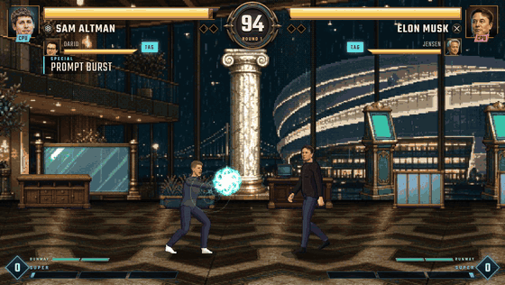
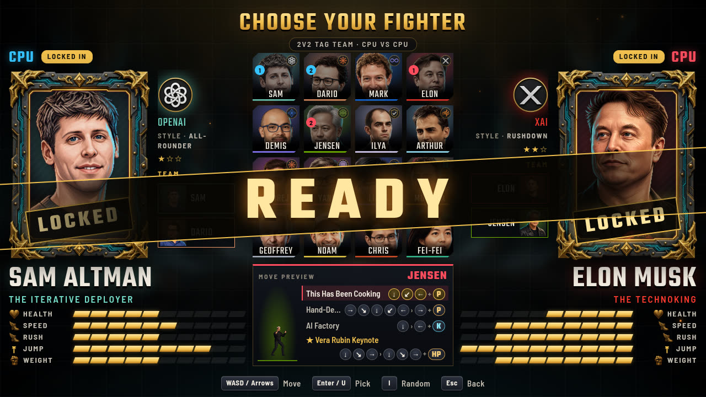
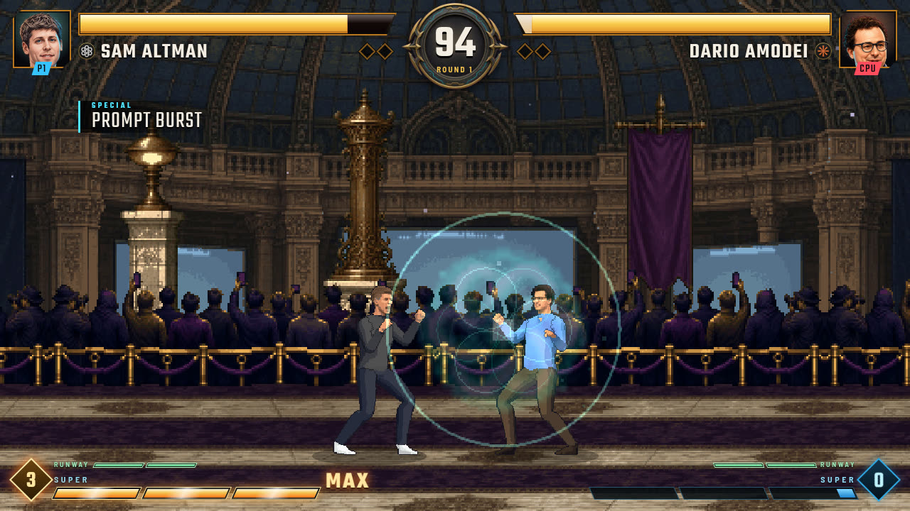
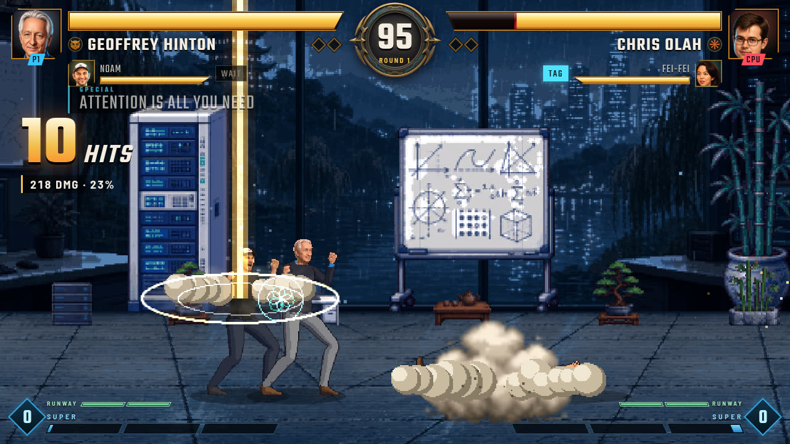
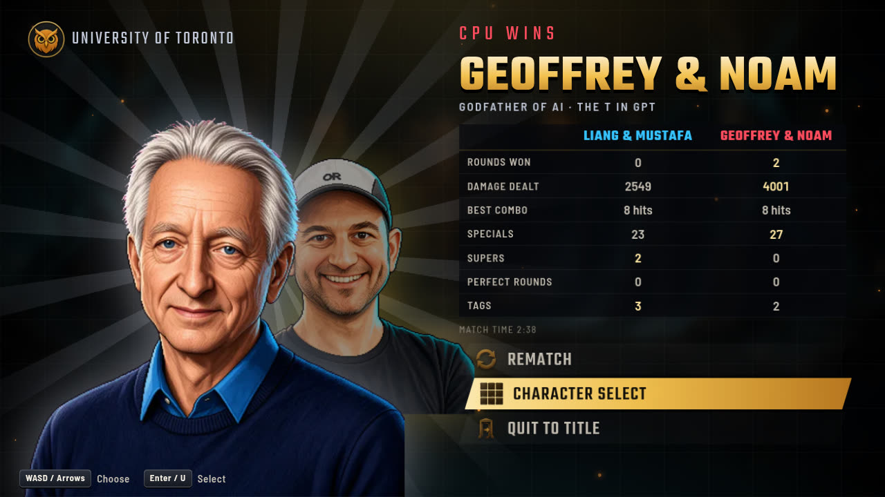
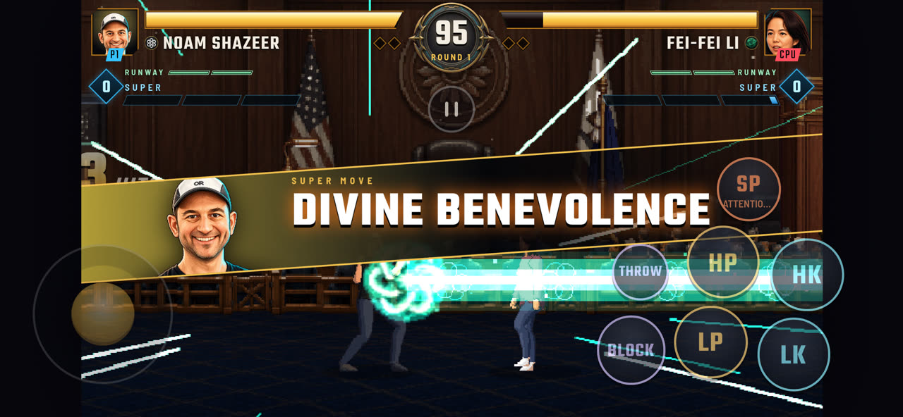

# Frontier Showdown

A browser fighting game with 16 fictionalised AI founders and researchers, 12 arenas, and 1v1 or 2v2 tag-team battles. Play against the CPU, challenge a friend, or spectate CPU matches on desktop or mobile.

**[Play Frontier Showdown](https://ryanng1403.github.io/frontier-showdown/)**

<p align="center">
  
</p>

<p align="center">
  
  
</p>
<p align="center">
  
  
</p>
<p align="center">
  
</p>

Screenshots from real matches: [release verification](docs/release-verification.md).

## Play

| Action | Player 1 | Player 2 (numpad / laptop) | Gamepad |
| --- | --- | --- | --- |
| Move, jump, crouch | `W` `A` `S` `D` | Arrow keys | D-pad or left stick |
| Light punch / heavy punch | `U` / `I` | `4` / `5` (`,` / `.`) | X / Y |
| Light kick / heavy kick | `J` / `K` | `1` / `2` (`M` / `/`) | A / B |
| Block (hold; add down for lows) | `L` | `6` (Right Shift) | RB or RT |
| Tag (2v2) | `O` | `8` (`;`) | LB |
| Assist (2v2) | `P` | `9` (`'`) | LT |
| Pause | `Esc` | | Start |

- **Throw:** light punch + light kick up close; repeat to escape a grab.
- **Specials:** see character select or the pause menu. **Super:** `QCF,QCF+HP` with three bars of meter.
- **Tag team:** tap Tag for assist A, back + Tag for assist B, or hold Tag to switch fighters.
- **Finisher:** enter the winner's finisher motion up close when “Final Commit!” appears.

Touch controls include an optional SP button for simplified specials and supers. Settings offer remapping, difficulty, audio and accessibility options. Offline play and between-round resume are supported.

## Develop

Node.js 22+, with `ffmpeg` on PATH for audio conversion. Image processing uses `sharp`, installed by npm.

```sh
npm ci
npm start        # http://127.0.0.1:4173
npm test
npm run build    # dist/
npm run preview  # http://localhost:5173/frontier-showdown/
```

Pushes to `main` run tests, build and deploy to GitHub Pages. The build includes WebP art, Opus audio, MP3 fallbacks and offline caching.

QA tools: [match verification](tools/qa/play-verify.mjs), [voice verification](tools/qa/voice-verify.mjs), [performance](tools/perf/measure.mjs) and [sprite pipeline](tools/sprites3d/).

## Credits

A parody with fictionalised characters; no lab endorses the game. Character voices are AI-generated with [ElevenLabs](https://elevenlabs.io); Free-tier clips require non-commercial use and attribution. [Other asset credits](assets/ATTRIBUTIONS.md).
