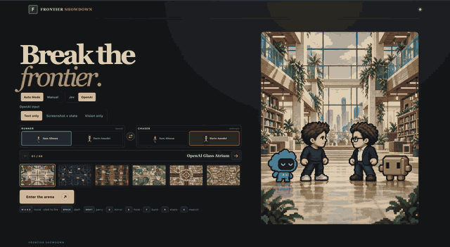
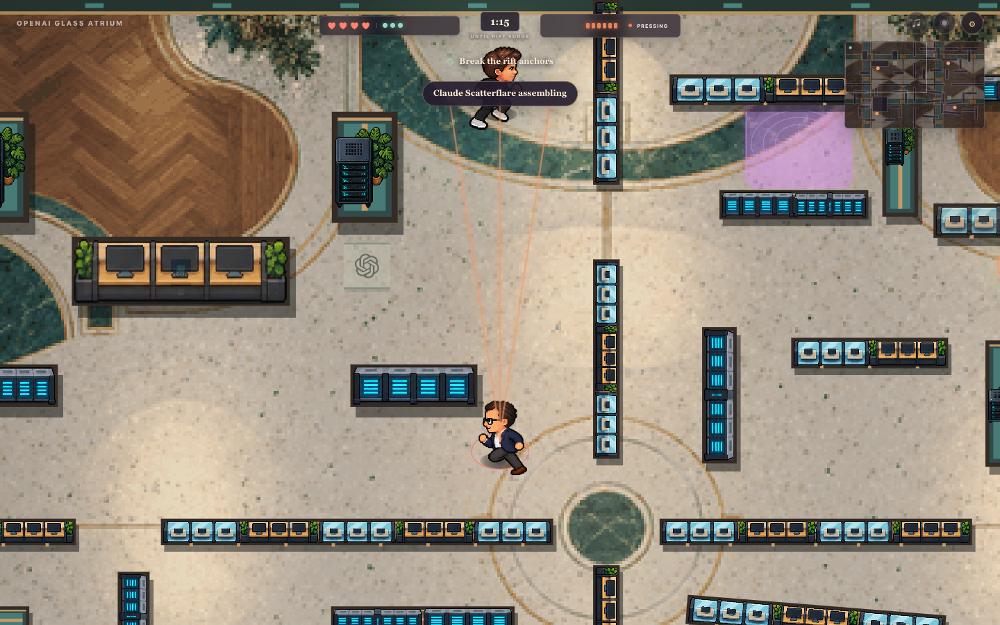
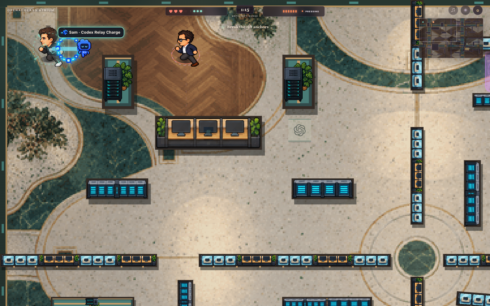

# Frontier Showdown

POV: the office tour went hostile. Pick a runner, pick a chaser, crack three anchors, and settle it across six research-lab arenas. Winner reaches AGI first.

<p align="center">
  
</p>

<p align="center">
  
  
</p>

## Run

Requires Node.js 22+.

```sh
cp .env.example .env
# Configure DECISION_PROVIDER and its API key in .env, then:
npm start
```

The start-page **Choice model** toggle selects Jev or OpenAI for the match. Its initial selection comes from `DECISION_PROVIDER` in `.env`, which defaults to `openai` when unset. The server reads provider keys such as `OPENAI_API_KEY` without exposing them to the browser. `JEV_ENV_FILE` can point to a separate environment file. Open [localhost:4173](http://127.0.0.1:4173). Without a configured provider key, the local tactical fallback still plays.

## Static build and GitHub Pages

The fighting game runs as a purely static site; `server.mjs` is only needed for local development and the optional decision-provider proxy. On a static host the local CPU AI plays.

```sh
npm run build     # writes dist/: manifest.json, sw.js, WebP art, Opus + MP3 audio, no WAV masters
npm run preview   # serves dist/ at http://localhost:5173/frontier-showdown/ with a plain static server
```

`npm run build` needs `ffmpeg` on the PATH (or `FFMPEG=/path/to/ffmpeg`) for audio and the `sharp` dev dependency for images; without them it copies the originals. `--atlas-webp` also writes lossless WebP fighter atlases (off by default because the sprite pipeline owns the atlas format).

To deploy, enable Pages once: **Settings → Pages → Build and deployment → Source: GitHub Actions**. After that, every push to `main` runs `.github/workflows/pages.yml` (tests, build, deploy) and the game is served at `https://<owner>.github.io/frontier-showdown/`. The workflow can also be started by hand from the Actions tab. Every URL is relative, so the site works under any subpath.

Return visits are served by the service worker in `dist/sw.js`: the app shell is precached per build, and fighter, stage and audio files are cached on first use under content-hashed URLs, so a deploy only re-downloads what changed. Progress (last mode, stage and fighters, per-fighter stats, match history and a resume point at round boundaries) is kept in IndexedDB, with settings and control remaps in localStorage. Measure memory, transfer size and frame pacing with `node tools/perf/measure.mjs --url <site>` (needs `npm i --no-save puppeteer-core`).

## Play

The game starts in **Auto Mode**, where the configured decision provider calls the plays for both fighters. Switch to **Manual** to control the runner yourself. Stasis Cast pins you in place while it charges. Mascot Charge sends your lab mascot down a lane to shove the chaser back.

- Move: **WASD** or arrows · Aim/fire: **pointer** or **Z**
- Phase Dash: **Space** · Mirror Echo: **Q** · Rift Hook: **E**
- Lantern Guard: **C** · Soul Burst: **X** · Stasis Cast: **R** · Mascot Charge: **G**

Six arenas: **OpenAI Glass Atrium**, **OpenAI Compute Studio**, **Anthropic Reading Room**, **Anthropic Living Studio**, **Paris AI Action Hall**, and **AI Impact Expo Pavilion**. Pick a map to read its field notes first.
